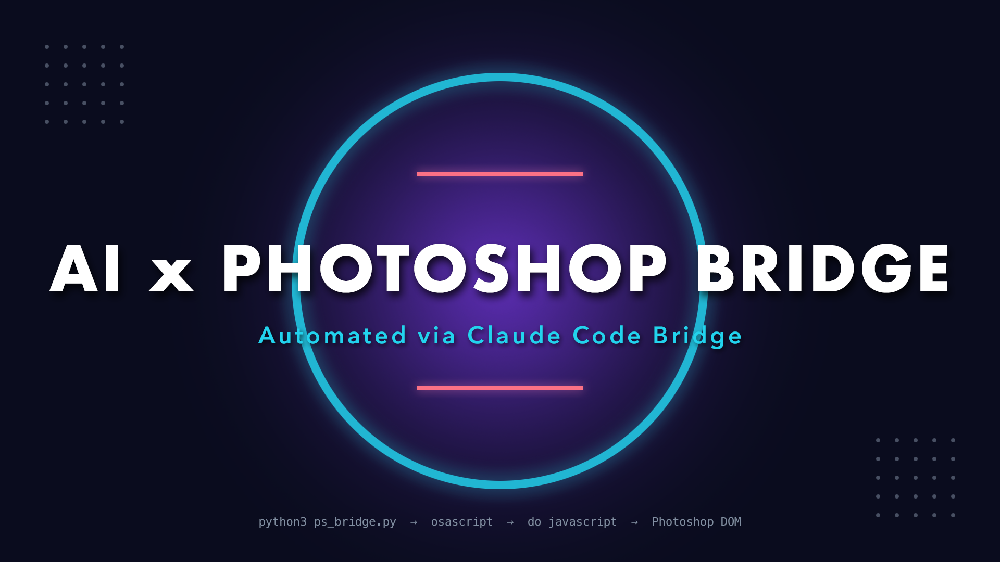

# AI x Photoshop Bridge

A Python bridge that lets an AI agent (Claude Code) send live commands into a running copy of **Adobe Photoshop on macOS**. It is used here to build a stylised 1920×1080 poster from scratch, one visible step at a time.



## Selected App & Method

| | |
|---|---|
| **Application** | Adobe Photoshop 2026 (v27.9.1), macOS |
| **Bridge type** | **Port**: live inter-process communication with an already-open Photoshop instance |
| **Mechanism** | Python → `osascript` (AppleScript / Apple Events) → Photoshop `do javascript` → ExtendScript (JSX) running against the Photoshop DOM |

There is no plugin, no file watching and no screen automation. Every command is an Apple Event that Photoshop runs immediately in its own scripting engine, and the result comes straight back to the terminal.

## Project Structure

```
photoshop-bridge/
├── ps_bridge.py        # reusable bridge: CLI + importable PhotoshopBridge class
├── generate_poster.py  # the visual task: builds the poster in 7 live steps
├── output/
│   └── poster.png      # rendered result (poster.psd is also written, but git-ignored)
└── README.md
```

## Setup & How to Run

**Requirements**
- macOS with Adobe Photoshop installed. The bridge finds the newest `/Applications/Adobe Photoshop*` automatically. Set `PS_APP="Adobe Photoshop 2025"` or pass `--app` to choose a different version.
- Python 3.8+ (the system `/usr/bin/python3` works). No third-party packages are needed.
- Photoshop should be open with no modal dialogs showing.
- The first time you run it, macOS asks to let your terminal control Photoshop. Click **OK**. You can change this later under *System Settings → Privacy & Security → Automation*.

**1. Health check (read-only, changes nothing)**
```bash
python3 ps_bridge.py --health
# Photoshop 27.9.1 | open documents: 0
```

**2. Send any ExtendScript from the terminal**
```bash
python3 ps_bridge.py -e "app.version"                 # inline JSX
python3 ps_bridge.py -e "app.activeDocument.name"
python3 ps_bridge.py -f my_script.jsx                 # JSX file
echo "app.documents.length" | python3 ps_bridge.py    # stdin
```
The value of the last JSX expression is printed. JSX errors are caught inside Photoshop and reported with a non-zero exit code:
```bash
python3 ps_bridge.py -e "nonexistent.foo"
# Error: ReferenceError: nonexistent is undefined (line 1)
```

**3. Generate the poster**
```bash
python3 generate_poster.py             # 1 s pause between steps so each one is visible
python3 generate_poster.py --delay 0   # full speed
```
Example run:
```
Connected: Photoshop 27.9.1 | open documents: 0
[1/7] Create 1920x1080 canvas with dark background ... ok (1.70s) - canvas 1920x1080 @ 72 DPI
[2/7] Add radial violet gradient glow ... ok (1.28s) - added gradient layer 'Violet Glow'
[3/7] Draw geometric accent shapes ... ok (3.09s) - drew ring, accent bars and corner dots
[4/7] Add title text layer ... ok (1.52s) - added title text layer
[5/7] Add subtitle and footer text layers ... ok (1.63s) - added subtitle and footer text layers
[6/7] Apply layer styles and opacity ... ok (1.55s) - applied drop shadows, outer glows and opacity
[7/7] Export PNG and PSD ... ok (1.89s) - exported PNG + PSD | layers (top to bottom): Footer, Subtitle, Title, Corner Dots, Accent Bars, Accent Ring, Violet Glow, Background
Done. Output written to .../photoshop-bridge/output
```
You can run the script again safely: it closes the previous poster document (without saving) before starting.

**4. Use the bridge from your own Python**
```python
from ps_bridge import PhotoshopBridge

ps = PhotoshopBridge()
print(ps.run('app.documents.add(800, 600, 72, "Scratch"); app.activeDocument.name'))
```

## Prompt & Action

### Prompt given to the AI agent (Claude Code)

The visual task was given in natural language as part of the assignment brief. These are the exact instructions:

> Write a Python script `generate_poster.py` (which uses `ps_bridge.py`) that sends JSX commands to Photoshop to build a professional visual poster from scratch:
> 1. Create a 1920x1080 canvas (RGB, 72 DPI) with a dark solid fill background.
> 2. Draw geometric accent shapes (e.g. a centered rectangle or circle with dynamic color).
> 3. Add a high-impact title text layer (e.g., "AI x PHOTOSHOP BRIDGE") with custom font size and color.
> 4. Add a subtitle text layer (e.g., "Automated via Claude Code Bridge").
> 5. Apply layer styles/effects (e.g., drop shadow or opacity adjustment) to elements.
>
> Run `generate_poster.py` so that Photoshop performs all these visible actions live.

The bridge itself came from this instruction:

> Create a Python bridge script `ps_bridge.py` that takes ExtendScript code as string input and routes it to Photoshop via `osascript -e 'tell application "<photoshop_app_name>" to do javascript "<escaped_jsx>"'`. Test the bridge with a simple non-destructive health check command.

### Step-by-step visual output in Photoshop

Each step is a separate bridge call, so you can watch the poster build up layer by layer in Photoshop's canvas and Layers panel:

| # | Action sent through the bridge | What appears in Photoshop | Layer(s) created |
|---|---|---|---|
| 1 | `app.documents.add(1920, 1080, 72, …, RGB)` then fill the selection with `#0A0C1E` | A new document filled with deep midnight navy | `Background` |
| 2 | Action Manager `Mk contentLayer` with a radial `gradientLayer` (violet `#7C3AED` → transparent, dithered), 70% opacity | A soft violet glow spreading from the centre | `Violet Glow` |
| 3 | Ellipse selections + `selection.fill` / `selection.clear`; rectangular selections; a 5×5 loop of small ellipses ×2 | A cyan ring (`#22D3EE`, 16 px stroke, 800 px diameter), two coral bars (`#FB7185`) above and below the centre, and grey dot grids in opposite corners | `Accent Ring`, `Accent Bars`, `Corner Dots` |
| 4 | Text layer, Futura Bold 118 px, tracking 40, white, centred | **AI x PHOTOSHOP BRIDGE** across the middle of the ring | `Title` |
| 5 | Text layers in Avenir Next DemiBold 46 px (cyan) and Menlo 22 px (slate) | The subtitle *Automated via Claude Code Bridge* and a pipeline footer along the bottom edge | `Subtitle`, `Footer` |
| 6 | Action Manager `setd Lefx` (Drop Shadow / Outer Glow) and `layer.opacity` | Drop shadows lift the title and subtitle, the ring and bars get a neon outer glow, and the dots and footer are toned down | (layer styles) |
| 7 | `saveAs` PNG + PSD, with `asCopy` | `output/poster.png` and the fully layered `output/poster.psd` | n/a |

Final layer stack (top to bottom): `Footer`, `Subtitle`, `Title`, `Corner Dots`, `Accent Bars`, `Accent Ring`, `Violet Glow`, `Background`. Every layer stays editable in the PSD: text is live text and the gradient is a live fill layer.

## Project Architecture

```
 Terminal / AI agent
        │  python3 ps_bridge.py -e "<JSX>"     (or PhotoshopBridge().run(jsx))
        ▼
 ps_bridge.py
   1. wrap JSX in try/catch + eval()           → errors come back as text
   2. osascript -e '<AppleScript>' <JSX>       → JSX is passed as argv
        │
        ▼  Apple Event: do javascript
 Adobe Photoshop (already running)
   ExtendScript engine runs the JSX against the DOM:
   app · documents · artLayers · textItem · selection · executeAction()
        │
        ▼  value of last expression
 stdout (or a PhotoshopError with Photoshop's error message)
```

How `ps_bridge.py` routes commands into Photoshop's DOM:

- **AppleScript as the transport.** The bridge runs a short AppleScript that does `tell application "Adobe Photoshop 2026" to do javascript (item 1 of argv)`. The application name is written into the script source because AppleScript can only recognise Photoshop's `do javascript` command when it knows the target app at compile time.
- **No string-escaping problems.** The assignment suggested putting escaped JSX inside the `-e` string. Instead, the JSX is passed as a separate **command-line argument** to `osascript`. Quotes, backslashes, newlines and Unicode in the JSX therefore never interact with AppleScript syntax, which removes a whole class of quoting bugs. (Tested with `"quote\" back\\slash"`.)
- **Readable errors.** The JSX is wrapped in a `try { eval(...) } catch (e) {...}` inside Photoshop. A failure comes back as `ReferenceError: … (line N)` instead of a bare AppleScript error number, and the Python side raises `PhotoshopError` and exits non-zero.
- **Return values.** Whatever the last JSX expression evaluates to is turned into a string and printed. That is how the health check reports Photoshop's version and document count, and how each poster step reports what it did.
- **DOM plus Action Manager.** `generate_poster.py` uses the ExtendScript DOM where it can (`documents.add`, `artLayers`, `textItem`, `selection.fill`, `opacity`). It uses Action Manager (`executeAction`) for features the DOM lacks: gradient fill layers, elliptical selections and layer effects. Shared helpers (`rgb`, `ellipseSel`, `applyEffects`, `withPixels`) are added to the start of each step, since every bridge call is independent.
- **Leaves your preferences unchanged.** `withPixels()` temporarily switches ruler and type units to pixels, then restores your own settings in a `finally` block.

## Troubleshooting

| Symptom | Fix |
|---|---|
| Command hangs, then times out | A dialog is open in Photoshop, or macOS is waiting for you to approve Automation access. Look for the prompt and click **OK**. |
| `Not authorized to send Apple events` | System Settings → Privacy & Security → Automation → allow your terminal to control Photoshop. |
| `No Adobe Photoshop installation found` | Pass the name explicitly: `--app "Adobe Photoshop 2025"` or `PS_APP=...`. |
| Font error on a text layer | Change the PostScript font names in `generate_poster.py`. To check one, run `python3 ps_bridge.py -e 'app.fonts.getByName("Futura-Bold").name'`. |
